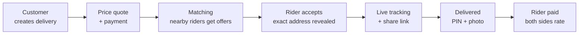

# dispatch-ng

An on-demand dispatch and courier marketplace for Nigeria, starting in Lagos.

Instead of saving random dispatch riders' numbers and calling them one by one, a customer opens the app, requests a delivery, and gets connected to a **verified rider nearby**. Both sides see what they need, the customer tracks the rider live (and can share a tracking link with the recipient), pays in-app, and the rider proves delivery with a PIN and photo.

> **Status:** MVP steps 1–2 (accounts, rider onboarding, quotes and orders) done. Next up is step 3 of the [roadmap](ROADMAP.md).

## How it works



## System design

The full step-by-step design lives in [`docs/system-design`](docs/system-design/README.md):

1. [Requirements](docs/system-design/01-requirements.md)
2. [Capacity estimates](docs/system-design/02-capacity.md)
3. [Architecture](docs/system-design/03-architecture.md)
4. [Data model](docs/system-design/04-data-model.md)
5. [Order lifecycle](docs/system-design/05-order-lifecycle.md)
6. [API](docs/system-design/06-api.md)
7. [Matching](docs/system-design/07-matching.md)
8. [Live tracking](docs/system-design/08-tracking.md)
9. [Pricing and payments](docs/system-design/09-payments.md)
10. [Trust flows](docs/system-design/10-trust.md)
11. [Privacy and security](docs/system-design/11-privacy-security.md)
12. [Roadmap and stack](docs/system-design/12-roadmap.md)

## Repository layout

```
dispatch-ng/
├── apps/
│   ├── api/          Node.js + TypeScript + Fastify backend (modular monolith)
│   │   ├── migrations/   SQL migrations (PostgreSQL + PostGIS)
│   │   └── src/
│   ├── web/          Next.js admin panel + public tracking page (not scaffolded yet)
│   └── mobile/       React Native customer + rider app (not scaffolded yet)
├── packages/
│   └── shared/       Types and the order status machine shared by every app
├── docs/
│   └── system-design/
├── docker-compose.yml    Postgres/PostGIS + Redis for local development
└── .env.example
```

## Getting started

Requirements: Node.js 22+, pnpm 9+, Docker.

```bash
pnpm install
cp .env.example .env
pnpm db:up          # start Postgres (on localhost:5433) + Redis
pnpm db:migrate     # create the schema
pnpm dev:api        # http://localhost:4000/health
```

Postgres is published on port **5433** so it doesn't clash with a locally installed Postgres on 5432.

In development, OTP codes are printed to the API log instead of being sent by SMS, and rider documents are saved under `apps/api/.data/uploads`.

Create an admin to review rider applications (quote the phone number if it has spaces):

```bash
pnpm --filter @dispatch/api make-admin 08012345678 "Ada Obi"
```

API reference for what's built so far: [Step 1: auth and riders](docs/api/step-1-auth-and-riders.md), [Step 2: orders and pricing](docs/api/step-2-orders-and-pricing.md). Prices are set in `apps/api/config/cities/lagos.json`.

Run checks:

```bash
pnpm typecheck
pnpm test           # API tests need Postgres running: pnpm db:up
```

The API tests create and reset a separate `dispatch_test` database on each run, so they never touch your development data. Set `TEST_DATABASE_URL` to use a different one.

## Tech stack

| Layer | Choice |
| --- | --- |
| Mobile | React Native (Expo) |
| Web | Next.js |
| API | Node.js, TypeScript, Fastify |
| Database | PostgreSQL + PostGIS |
| Realtime / cache / jobs | Redis, BullMQ |
| Storage | S3-compatible bucket |
| Payments | Nigerian payment gateway (vendor to confirm) |
