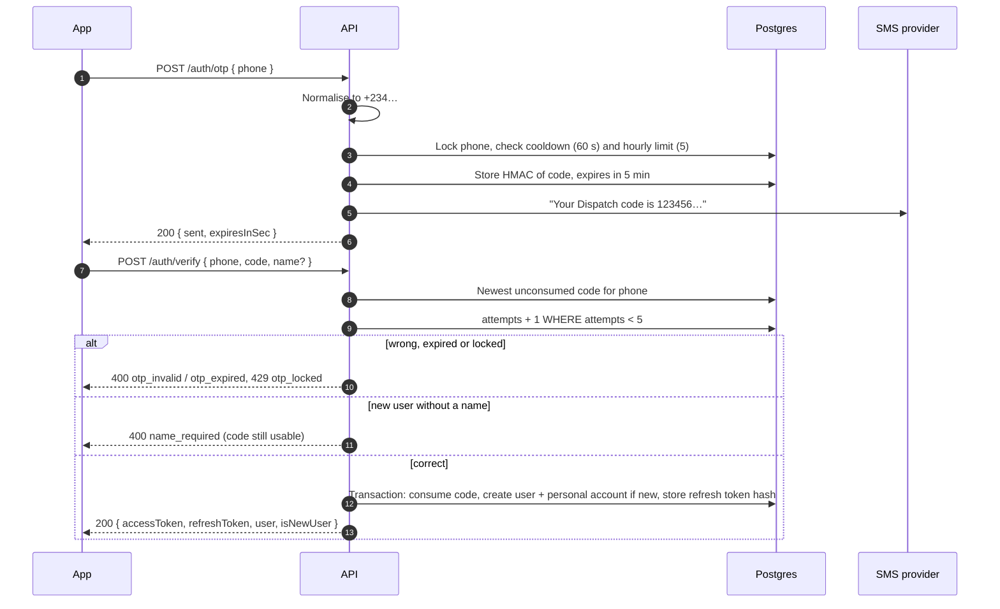

# Step 1 API: accounts and rider onboarding

Phone OTP login, sessions, rider applications with document upload, and admin review. Built in `apps/api/src/modules/{auth,riders,admin}`. Design background: [06-api](../system-design/06-api.md), [10-trust](../system-design/10-trust.md), [11-privacy-security](../system-design/11-privacy-security.md).

All bodies are JSON unless stated otherwise. Signed-in routes need `Authorization: Bearer <accessToken>`.

## OTP login



### `POST /auth/otp`

Sends a 6-digit code by SMS. Accepts the usual ways of writing a Nigerian mobile number (`0801 234 5678`, `2348012345678`, `+2348012345678`).

```http
POST /auth/otp
{ "phone": "0801 234 5678" }
→ 200 { "sent": true, "expiresInSec": 300 }
```

Errors: `400 invalid_phone`, `429 otp_cooldown` (a code was sent in the last 60 s), `429 otp_limit` (5 codes in the last hour), `429 rate_limited` (per-IP limit).

### `POST /auth/verify`

Exchanges the code for a session. `name` is only needed the first time a phone number signs in.

```http
POST /auth/verify
{ "phone": "08012345678", "code": "123456", "name": "Ada Obi" }
→ 200 {
  "accessToken": "eyJ…",
  "accessTokenExpiresIn": 900,
  "refreshToken": "kq3…",
  "user": { "id": "…", "name": "Ada Obi", "phone": "+2348012345678", "role": "customer" },
  "isNewUser": true
}
```

Only the newest unconsumed code for the phone is checked. Each attempt counts, right or wrong; after 5 the code is locked and the user must request a new one. Signing in consumes that code and any older unused codes for the same phone.

Errors: `400 invalid_phone`, `400 otp_invalid`, `400 otp_expired`, `429 otp_locked`, `400 name_required`, `429 rate_limited`.

### `POST /auth/refresh`

```http
POST /auth/refresh
{ "refreshToken": "kq3…" }
→ 200 { "accessToken": "…", "accessTokenExpiresIn": 900, "refreshToken": "new…" }
```

Each refresh token works once. Presenting one that was already used signs out every session from that login, because it means the token was copied.

Errors: `401 invalid_refresh_token`, `401 refresh_token_reused`, `401 refresh_token_expired`.

### `POST /auth/logout`

```http
POST /auth/logout
{ "refreshToken": "kq3…" }
→ 204
```

Revokes the whole login the token belongs to. Unknown tokens are ignored.

## Riders

### `POST /riders/apply` (signed in, not admin)

```http
POST /riders/apply
{ "vehicleType": "bike", "plate": "lnd 123 ab" }
→ 201 {
  "status": "pending", "vehicleType": "bike", "plate": "LND 123 AB",
  "rejectionReason": null, "approvedAt": null, "reviewedAt": null, "createdAt": "…"
}
```

Makes the user a `rider` with a `pending` profile. A rejected rider can apply again; this clears the earlier rejection and keeps their documents.

Errors: `403 forbidden` (admins), `409 already_applied`.

### `GET /riders/me` (rider)

```http
GET /riders/me
→ 200 {
  "status": "pending", "vehicleType": "bike", "plate": "LND 123 AB", "rejectionReason": null, …,
  "documents": [
    { "id": "…", "kind": "nin", "contentType": "application/pdf", "sizeBytes": 183422, "verifiedAt": null, "createdAt": "…" }
  ],
  "missingDocuments": ["licence", "selfie"]
}
```

### `POST /riders/me/documents/:kind` (rider, application pending)

`kind` is `nin`, `licence`, `selfie` or `vehicle` (`vehicle` is optional). Send `multipart/form-data` with one file, at most 5 MB.

```bash
curl -X POST http://localhost:4000/riders/me/documents/nin \
  -H "Authorization: Bearer $TOKEN" \
  -F "file=@nin.pdf"
→ 201 { "id": "…", "kind": "nin", "contentType": "application/pdf", "sizeBytes": 183422, "verifiedAt": null, "createdAt": "…" }
```

The type is detected from the file's first bytes (JPEG, PNG or PDF); the client's `Content-Type` is ignored. A selfie must be JPEG or PNG. Uploading the same kind again replaces the earlier file. Files are stored privately under a key the server generates (`riders/<userId>/<kind>-<uuid>.<ext>`).

Errors: `409 profile_not_editable`, `400 file_required`, `413 file_too_large`, `415 unsupported_file_type`.

## Admin

Every `/admin` route needs the `admin` role. Create the first admin with `pnpm --filter @dispatch/api make-admin <phone> <name>`. Ids must be UUIDs (`400 validation_error` otherwise).

### `GET /admin/riders?status=pending`

`status` is `pending` (default), `approved`, `rejected` or `suspended`. Oldest first.

```http
GET /admin/riders
→ 200 { "riders": [
  { "id": "…", "name": "Musa Bello", "phone": "+2348031112222", "status": "pending",
    "vehicleType": "bike", "plate": "LND 123 AB", "createdAt": "…", "documentKinds": ["nin", "selfie"] }
] }
```

### `GET /admin/riders/:id`

The same fields plus `rejectionReason`, `approvedAt`, `reviewedBy`, `reviewedAt`, `documents` and `missingDocuments`. `404 rider_not_found`.

### `GET /admin/documents/:id`

Returns the file itself with its stored `Content-Type`, `Cache-Control: private, no-store` and `X-Content-Type-Options: nosniff`. `404 document_not_found`.

### `POST /admin/riders/:id/verify`

```http
POST /admin/riders/:id/verify
{ "decision": "approve" }
→ 200 { "id": "…", "status": "approved" }

POST /admin/riders/:id/verify
{ "decision": "reject", "reason": "Licence photo is blurry" }
→ 200 { "id": "…", "status": "rejected", "rejectionReason": "Licence photo is blurry" }
```

Approving needs `nin`, `licence` and `selfie`; it records who reviewed and when and marks the documents verified. Rejecting needs a reason, which the rider sees in `GET /riders/me`.

Errors: `404 rider_not_found`, `409 rider_not_pending`, `409 documents_missing` (message names the missing kinds), `400 reason_required`.

## Errors

Every error has the shape:

```json
{ "error": { "code": "otp_invalid", "message": "That code is not correct" } }
```

Validation errors also list what was wrong:

```json
{ "error": { "code": "validation_error", "message": "The request is not valid",
             "details": [{ "path": "phone", "message": "Invalid input: expected string, received undefined" }] } }
```

| Status | Codes |
| --- | --- |
| 400 | `validation_error`, `invalid_phone`, `otp_invalid`, `otp_expired`, `name_required`, `file_required`, `reason_required` |
| 401 | `unauthorized`, `invalid_token`, `invalid_refresh_token`, `refresh_token_reused`, `refresh_token_expired` |
| 403 | `forbidden` |
| 404 | `not_found`, `rider_not_found`, `document_not_found` |
| 409 | `already_applied`, `profile_not_editable`, `rider_not_pending`, `documents_missing` |
| 413 | `file_too_large` |
| 415 | `unsupported_file_type` |
| 429 | `otp_cooldown`, `otp_limit`, `otp_locked`, `rate_limited` |
| 500 | `internal_error` |

## Limits

| What | Limit |
| --- | --- |
| Access token | 15 minutes |
| Refresh token | 30 days, single use |
| OTP code | 5 minutes, 5 attempts |
| OTP sends per phone | 1 per 60 s, 5 per hour |
| `/auth/otp` and `/auth/verify` per IP | 20 per hour each (`AppDeps.authRateLimitPerHour`) |
| Document upload | 5 MB, JPEG/PNG/PDF |
