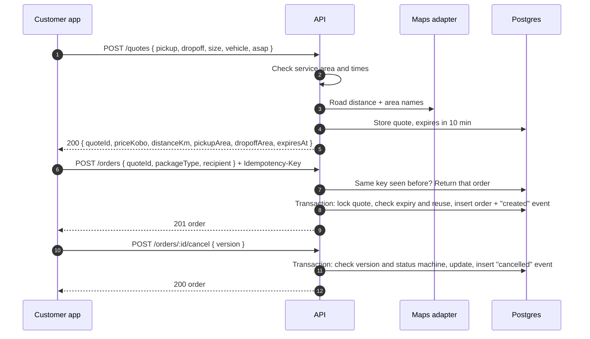

# Step 2 API: quotes, orders and cancellation

A customer gets a price, turns it into an order and can cancel it. Built in `apps/api/src/modules/{pricing,orders}`. Design background: [05-order-lifecycle](../system-design/05-order-lifecycle.md), [06-api](../system-design/06-api.md), [09-payments](../system-design/09-payments.md). Auth and error format are as in [Step 1](step-1-auth-and-riders.md).

Payment arrives in Step 5, so for now orders stay in `created` until they are cancelled.



## Pricing

```
price = round_to_50((base + km × per_km) × size_multiplier × vehicle_multiplier + asap_fee)
rider payout = price × (100 − platform fee %), rounded down to the kobo
```

The values live in [`apps/api/config/cities/lagos.json`](../../apps/api/config/cities/lagos.json) (all money in kobo) and are checked when the server starts. Point `CITY_CONFIG` at another file to change them. Each quote stores the settings it was priced with.

| Setting | Lagos |
| --- | --- |
| `baseKobo` | 100000 (₦1,000) |
| `perKmKobo` | 25000 (₦250) |
| `sizeMultiplier` | small 1.0, medium 1.2, large 1.5 |
| `vehicleMultiplier` | bike 1.0, car 1.8, van 2.5 |
| `asapFeeKobo` | 50000 (₦500), ASAP orders only |
| `roundToKobo` | 5000 (₦50) |
| `platformFeePercent` | 20 |

Example: 10 km, small, bike, ASAP → (₦1,000 + 10 × ₦250) + ₦500 = **₦4,000**; the rider gets ₦3,200.

**Distance:** the maps vendor isn't chosen yet. In development, `EstimateMaps` uses the straight-line distance × 1.4 and names the area after the nearest of about 20 Lagos neighbourhoods, so prices are approximate. Tests use a fixed distance.

## `POST /quotes` (customer)

```http
POST /quotes
{
  "pickup":  { "lat": 6.4474, "lng": 3.4723, "address": "12 Admiralty Way, Lekki Phase 1" },
  "dropoff": { "lat": 6.4281, "lng": 3.4219, "address": "5 Adeola Odeku St, Victoria Island" },
  "size": "small",
  "vehicle": "bike",
  "asap": true
}
→ 200 {
  "quoteId": "…", "priceKobo": 400000, "distanceKm": 10, "durationMin": 30,
  "pickupArea": "Lekki Phase 1", "dropoffArea": "Victoria Island", "expiresAt": "…"
}
```

- `vehicle` defaults to `bike`, `asap` to `true`.
- For a scheduled pickup send `"asap": false, "scheduledAt": "2026-10-20T09:00:00+01:00"`, between 30 minutes and 7 days ahead. There's no ASAP fee.
- `deliverBy` (optional) must be after the pickup time.
- `address` is the text the customer typed or picked. The area comes from the maps adapter, never from the client, so the area shown to riders can't contain the exact address.
- Limited to 60 a minute per IP, because each quote is a paid maps call.

Errors: `400 validation_error`, `400 invalid_schedule`, `400 outside_service_area`, `400 same_location`, `403 forbidden` (not a customer).

## `POST /orders` (customer)

Requires an `Idempotency-Key` header: 8–100 letters, digits, `-` or `_`, new for each order. Generate a UUID per checkout attempt and reuse it on retries.

```http
POST /orders
Idempotency-Key: 9b2f6c0e-4c1a-4d0b-9a57-3f0f3c1d2e11
{
  "quoteId": "…",
  "packageType": "food",
  "notes": "Call at the gate",
  "recipient": { "name": "Ada", "phone": "0803 111 2222" }
}
→ 201 {
  "id": "…", "status": "created", "statusLabel": "Awaiting payment", "version": 0,
  "pickup":  { "lat": 6.4474, "lng": 3.4723, "address": "12 Admiralty Way, Lekki Phase 1", "area": "Lekki Phase 1" },
  "dropoff": { "lat": 6.4281, "lng": 3.4219, "address": "5 Adeola Odeku St, Victoria Island", "area": "Victoria Island" },
  "recipient": { "name": "Ada", "phone": "+2348031112222" },
  "size": "small", "packageType": "food", "vehicle": "bike", "notes": "Call at the gate",
  "asap": true, "scheduledAt": null, "deliverBy": null, "distanceM": 10000, "priceKobo": 400000,
  "timeline": [{ "status": "created", "at": "…" }],
  "createdAt": "…", "updatedAt": "…"
}
```

Repeating a request with the same key returns the same order (`201`, header `Idempotent-Replayed: true`), even if both arrive at once. Keys are scoped to the customer. Each quote can become one order.

Errors: `400 idempotency_key_required`, `400 invalid_phone`, `404 quote_not_found`, `409 quote_expired`, `409 quote_used`, `422 idempotency_key_reused` (same key, different body).

## `GET /orders/:id`

What you get depends on who you are ([11-privacy-security](../system-design/11-privacy-security.md)):

| Viewer | Gets |
| --- | --- |
| The customer | The order as above, with price and timeline |
| The assigned rider | Exact addresses, recipient, customer name with **masked** phone, `payoutKobo` instead of the price, no timeline |
| An admin | Everything: customer view + customer contact, `riderId`, `riderPayoutKobo`, timeline with actor and note |
| Anyone else, including riders who haven't accepted it | `404 order_not_found` |

A rider is only ever "assigned" after accepting (Step 3), so exact addresses never reach a rider before accept.

## `POST /orders/:id/cancel`

Send the `version` you last saw; a stale one returns `409 version_conflict` (refresh and try again). `reason` is optional and is stored on the order's event.

```http
POST /orders/:id/cancel
{ "version": 0, "reason": "Changed my mind" }
→ 200 { …, "status": "cancelled", "version": 1, "timeline": [{ "status": "created" }, { "status": "cancelled" }] }
```

Who can cancel follows the shared status machine (`packages/shared/src/order-status.ts`):

| Status | Customer | Assigned rider | Admin |
| --- | :---: | :---: | :---: |
| `created`, `searching` | ✅ | — | ✅ |
| `accepted`, `to_pickup` | ✅ | ✅ | ✅ |
| `picked_up` and later | ❌ (report an issue instead) | ❌ | ❌ |

Refunds and the cancellation fee after the rider is on the way arrive with payments in Step 5.

Errors: `404 order_not_found`, `409 version_conflict`, `409 invalid_transition`.

## Status changes

Every status change after creation goes through `transitionOrder()` in `modules/orders/transitions.ts`, which locks the order, checks `version`, calls `assertTransition()` from `@dispatch/shared`, bumps `version` and writes an `order_events` row. Steps 3–6 use the same function for accept, pickup and delivery.

## New error codes

| Status | Codes |
| --- | --- |
| 400 | `invalid_schedule`, `outside_service_area`, `same_location`, `idempotency_key_required` |
| 404 | `quote_not_found`, `order_not_found` |
| 409 | `quote_expired`, `quote_used`, `version_conflict`, `invalid_transition` |
| 422 | `idempotency_key_reused` |
