# Step 1: Requirements

Build the core delivery loop now; design every table for what comes later. The MVP serves one city (Lagos).

```mermaid
flowchart LR
  subgraph MVP["MVP: build now"]
    direction TB
    m1[Phone + OTP sign-up for both sides]
    m2[Create order with package details]
    m3[Upfront, rule-based price]
    m4[Rider onboarding + admin approval]
    m5[Broadcast to nearby riders]
    m6[Exact address hidden until accept]
    m7[Live GPS + status timeline]
    m8[Share tracking link, no login]
    m9[PIN + photo proof of delivery]
    m10[In-app payment, payouts, ratings]
    m11[Report an issue, admin queue]
  end
  subgraph LATER["Later: designed for, not built"]
    direction TB
    l1[Scored matching, customer picks rider]
    l2[Surge and traffic-aware pricing]
    l3[Saved addresses and templates]
    l4[Signature proof]
    l5[Wallets, cash on delivery]
    l6[Automated ID checks]
    l7[Dispute SLAs, automatic refunds]
    l8[Analytics dashboards]
    l9[Business accounts and teams]
    l10[Bulk and scheduled orders]
    l11[Monthly invoices]
  end
  MVP --> LATER
```

## Order form fields (MVP)

| Field | Values |
| --- | --- |
| Pickup location | Map pin + address text |
| Drop-off location | Map pin + address text |
| Pickup time | ASAP or a scheduled time |
| Preferred delivery time | Optional window |
| Package size | `small`, `medium`, `large` |
| Package type | `food`, `perishable`, `non_perishable`, `fragile`, `documents`, `clothing`, `other` |
| Vehicle | `bike`, `car`, `van` (bike default) |
| Notes | Optional free text |
| Package photo | Optional image |
| Recipient name and phone | Needed for the delivery PIN SMS |

## Non-functional targets

| Target | Why |
| --- | --- |
| Riders see a new job within 2–3 s | Riders accept fast or the customer waits |
| Customer map lags under 5 s | Location pings every 3–5 s while a job is active |
| Works on 3G and low-end Android | Batch and compress pings, tolerate offline gaps |
| One rider per order | Accept is an atomic update; no double assignment |
| Charge exactly once | Idempotency keys on order and payment calls |
| Private by default | Exact addresses and phone numbers only to the assigned rider |

## Extensibility rule

An order belongs to an **account**, not directly to a person. A personal account has one member; a business account (Phase 3) has many. This is what lets business features arrive without reworking the data model.
