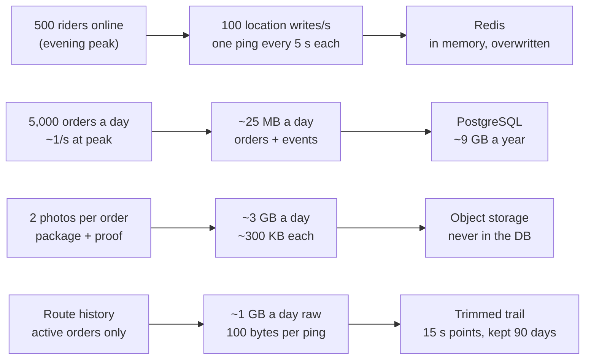

# Step 2: Capacity estimates

Location pings, not orders, are the heaviest load: about 100 writes per second at peak.

These are planning assumptions for year one in Lagos, not market data. Replace them once real traffic comes in.

| Metric | Assumption | Derived load |
| --- | --- | --- |
| Registered riders | 2,000 | — |
| Riders online at peak | 500 | — |
| Orders per day | 5,000 | ~0.06/s average, ~1/s at peak |
| Ping interval | 5 s | 500 ÷ 5 = 100 writes/s |
| Tracking viewers per order | 2 | a few hundred WebSocket connections |
| Order + events | ~5 KB | ~25 MB/day, ~9 GB/year |
| Location history | ~100 B per ping | ~0.9 GB/day raw |
| Photos | 2 × 300 KB per order | ~3 GB/day |

## Consequences

1. Current rider positions live in **Redis**, not Postgres. 100 writes/s of throwaway data is cheap in memory and wasteful in a relational database.
2. Location history is kept only for active orders, downsampled to one point per 15 s, and expired after 90 days. That leaves a route trail for disputes without storing every ping.
3. At this scale one Postgres instance and a small Redis are enough. No sharding, no separate services yet.
