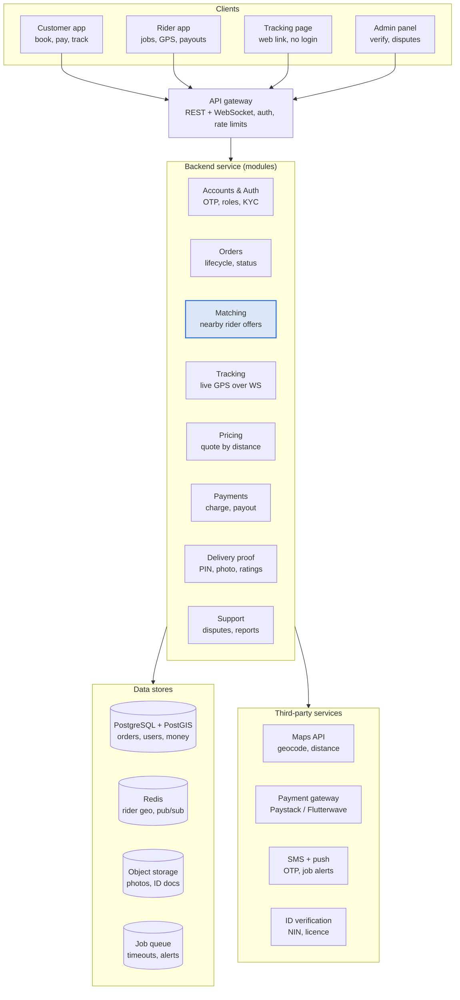

# Step 3: High-level architecture

Four apps share one backend; live rider positions sit in Redis. The backend is one modular service, split into separate services only when load demands it.

## Components

| Component | Responsibility | Notes |
| --- | --- | --- |
| Customer app | Create orders, pay, track, rate, report | React Native |
| Rider app | Go online, receive offers, accept, update status, upload proof | React Native, background GPS |
| Tracking page | Public read-only page behind a random token | Next.js, no login |
| Admin panel | Approve riders, manage orders, resolve disputes | Next.js, staff login |
| API gateway | Auth, rate limits, routes REST and WebSocket | Same Node process in MVP |
| Matching | Finds riders, sends offers, expands radius | The core of the product |
| Tracking | Ingests pings, fans out via Redis pub/sub | Separate process if load grows |
| Payments | Gateway charge, webhook, ledger, payouts | Idempotent everywhere |

## Why a modular monolith

At MVP scale (Step 2) a single service is cheaper to run, debug and deploy. Modules talk through in-process interfaces with clear boundaries, so Tracking or Matching can be pulled out into their own services later without rewriting callers.

## Vendor choices (to confirm)

Payment gateway, SMS and ID-verification vendors are options, not decisions. Compare current pricing, coverage and settlement terms before integrating. Each vendor sits behind an adapter interface so it can be swapped.
