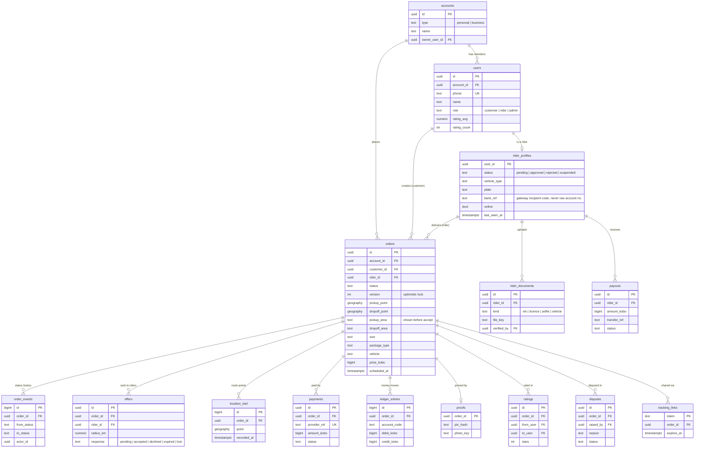

# Step 4: Data model

Every table hangs off the order; orders belong to an account, not a person. Money is stored as integer **kobo** (₦1 = 100 kobo) to avoid floating-point errors.

## Key design choices

- **`orders.version`** blocks double acceptance. Accept runs `UPDATE orders SET rider_id = $1, status = 'accepted', version = version + 1 WHERE id = $2 AND status = 'searching' AND version = $3`. Zero rows updated means another rider won.
- **`pickup_area` vs `pickup_point`.** Riders see the area (e.g. "Lekki Phase 1") before accepting; the exact point is returned only to the assigned rider.
- **`bank_ref`** stores the payment gateway's transfer-recipient code, not the raw bank account number.
- **`ledger_entries`** is double-entry: every naira in or out is a debit and a matching credit, so payouts and refunds always reconcile.
- **`order_events`** is an append-only audit trail used by support and disputes.

The executable schema is in [`apps/api/migrations/001_init.sql`](../../apps/api/migrations/001_init.sql).
