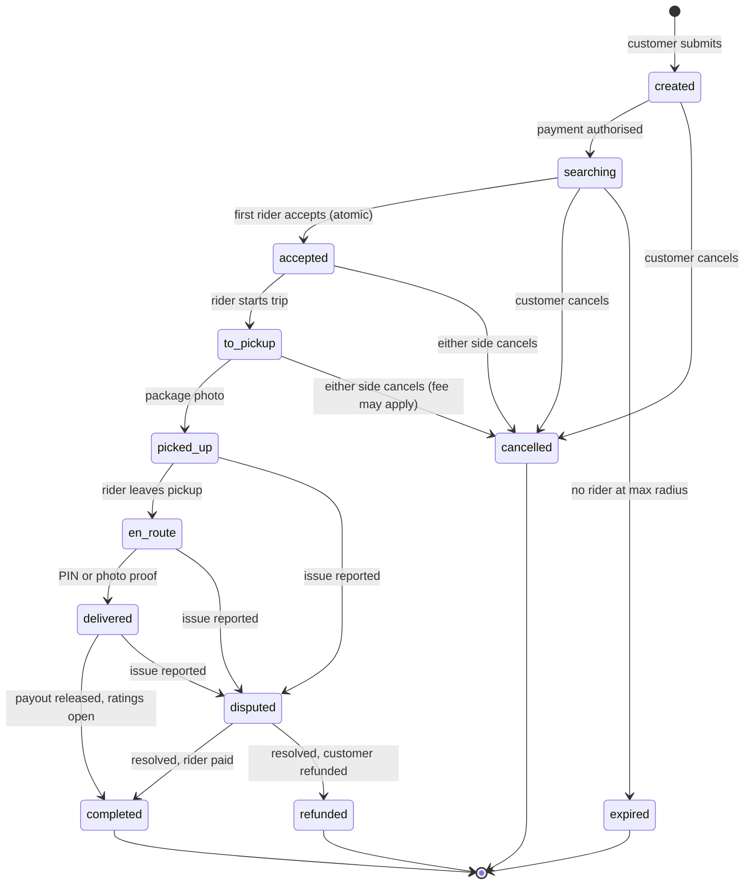

# Step 5: Order lifecycle

One rider wins the order; after pickup it can only finish or go to support. Every status change writes one row to `order_events`, and the server rejects any change that isn't an arrow below.

## What the customer sees

| Status | Customer label |
| --- | --- |
| `searching` | Finding a rider |
| `accepted` | Rider accepted |
| `to_pickup` | Heading to pickup |
| `picked_up` | Package picked up |
| `en_route` | On the way |
| `delivered` / `completed` | Delivered |

## Rules

- Only the assigned rider can move an order from `accepted` through `delivered`.
- Cancellation before `to_pickup` is a full refund; after the rider is on the way a cancellation fee may apply (amount to decide).
- Once the package is picked up, the order cannot be cancelled. It either completes or goes to `disputed`, and the rider's payout is held.
- `expired` triggers an automatic full refund.

The transition table is code in [`packages/shared/src/order-status.ts`](../../packages/shared/src/order-status.ts) so the API and apps share one source of truth.
