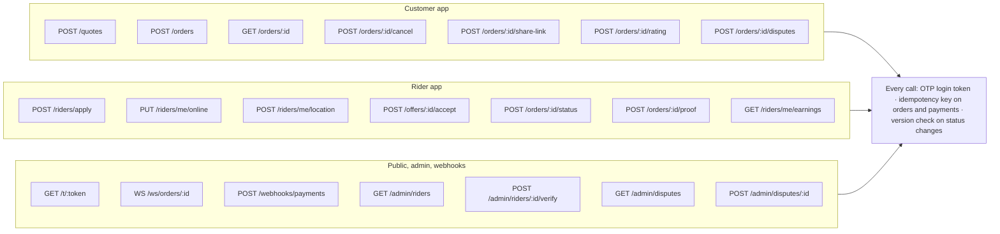

# Step 6: Core API

Three callers, about twenty endpoints, one set of safety rules. REST for actions; one WebSocket per active order for live updates.



## Auth

| Endpoint | Purpose |
| --- | --- |
| `POST /auth/otp` | Send a 6-digit code by SMS to a Nigerian phone number |
| `POST /auth/verify` | Exchange the code for a short-lived access token + refresh token |
| `POST /auth/refresh` | Rotate tokens |

## Examples

**Create a quote**

```http
POST /quotes
{
  "pickup":  { "lat": 6.4474, "lng": 3.4723 },
  "dropoff": { "lat": 6.4281, "lng": 3.4219 },
  "size": "small",
  "vehicle": "bike",
  "asap": true
}
→ 200 { "quoteId": "q_…", "priceKobo": 450000, "distanceKm": 7.2, "expiresAt": "…" }
```

**Create an order** (uses the quote; `Idempotency-Key` header required)

```http
POST /orders
Idempotency-Key: 7c1e…
{ "quoteId": "q_…", "packageType": "food", "notes": "Call at gate", "recipient": { "name": "Ada", "phone": "+2348012345678" } }
→ 201 { "orderId": "o_…", "status": "created", "payment": { "authorizationUrl": "…" } }
```

**Offer as a rider sees it before accepting**

```json
{
  "offerId": "of_…",
  "pickupArea": "Lekki",
  "dropoffArea": "Victoria Island",
  "size": "small",
  "packageType": "food",
  "asap": true,
  "payoutKobo": 360000,
  "distanceToPickupKm": 1.4,
  "expiresInSec": 20
}
```

**Accept** returns `200` with the exact addresses and recipient contact, or `409 Conflict` if another rider got there first.

## Rules every call follows

- **Auth:** bearer token from phone OTP; role checked per route.
- **Idempotency:** `Idempotency-Key` on order creation, payment and payout calls; repeats return the first response.
- **Concurrency:** status changes send the order `version`; a stale version returns `409`.
- **Errors:** JSON `{ "error": { "code": "offer_taken", "message": "…" } }`.
- **Rate limits:** per user and per IP; stricter on `/auth/otp` and `/t/:token`.
