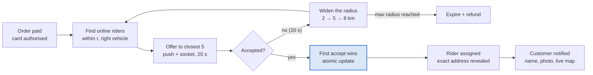

# Step 7: Matching and radius expansion

Offers go out in widening circles until one rider taps accept. MVP matching is nearest first, first to accept wins; scoring by rating and vehicle comes later.

## How it works

1. **Rider positions.** Each online rider's latest ping is written to a Redis geo set per vehicle type: `GEOADD riders:bike <lng> <lat> <riderId>`.
2. **Search.** `GEOSEARCH riders:bike FROMLONLAT <pickup> BYRADIUS 2 km ASC COUNT 20`, then filter out riders who are busy, offline for more than 30 s, or already offered this order.
3. **Offer.** Send to the closest 5 by push notification and WebSocket. Write one `offers` row each with `response = pending`.
4. **Timeout.** A delayed job fires after 20 s. If the order is still `searching`, widen to the next radius and repeat.
5. **Accept.** The rider's accept runs the version-checked `UPDATE` from [Step 4](04-data-model.md). Exactly one succeeds; the others get `409` and their offer is marked `lost`.
6. **Give up.** At the largest radius with no taker, the order moves to `expired` and the payment is refunded.

## Starting parameters (tune with real data)

| Parameter | Start value |
| --- | --- |
| Radius steps | 2 km → 5 km → 8 km |
| Offer window | 20 s per round |
| Riders per round | 5 |
| Stale-location cutoff | 30 s |

## Later: scored matching

Replace "closest 5" with a score such as `w1·distance + w2·(5 − rating) + w3·recent_declines − w4·acceptance_rate`, and optionally let the customer choose between the first few riders who accept. The `offers` table already records everything needed to train and evaluate this.
