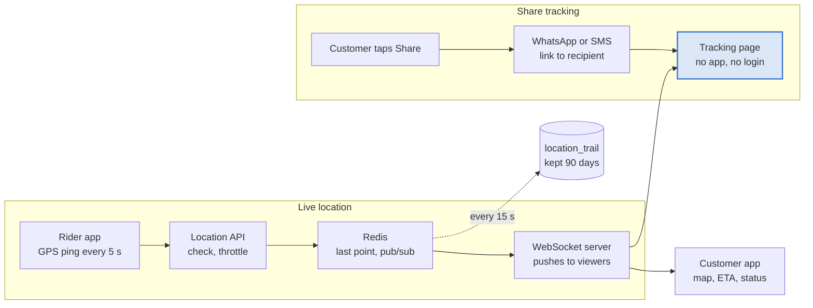

# Step 8: Live tracking and shareable links

Riders ping every 5 s; Redis fans each point out to everyone watching.

## Location pipeline

1. The rider app sends `{lat, lng, heading, speed, accuracy, recordedAt}` every 5 s while online, every 3 s during an active order.
2. The API rejects points with poor accuracy, impossible speed jumps, or timestamps in the future.
3. Redis stores the latest point (`GEOADD` for matching, a hash for the full reading) and publishes to channel `order:<id>` if the rider has an active order.
4. The WebSocket server subscribes to `order:<id>` for every connected viewer and pushes the point and current ETA.
5. One point every 15 s is copied to `location_trail` for disputes.

**Bad networks:** when the signal drops, the rider app queues pings locally and sends them as a batch on reconnect, so the map catches up instead of freezing.

## Share-tracking link

| Rule | Detail |
| --- | --- |
| Token | 128-bit random, URL-safe: `https://<domain>/t/<token>` |
| Read-only | Shows map, ETA, status, rider first name, photo, vehicle and plate |
| Never shows | Phone numbers, exact pickup address, price |
| Expires | When the order reaches `completed`, `cancelled` or `expired`; the page then shows the final status only |
| Rate-limited | Per token and per IP |
| Revocable | Customer can turn the link off from the app |

The recipient needs no account and no app: the page is server-rendered by Next.js and opens a WebSocket scoped to that token.
