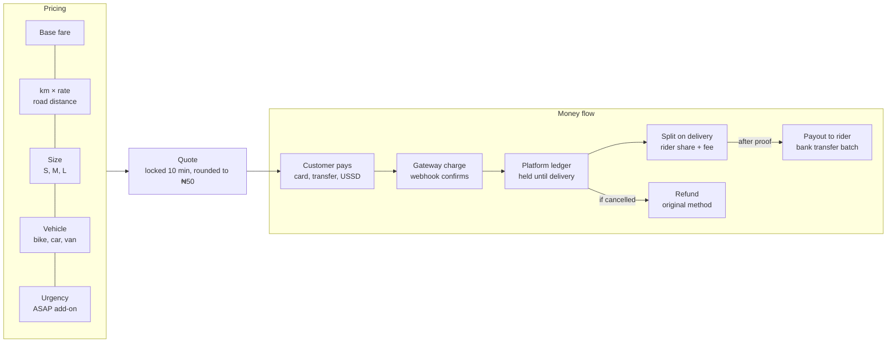

# Step 9: Pricing, payments and payouts

Customers pay upfront; riders are paid after proof of delivery.



## Price formula (MVP)

```
price = round_to_50( (base + km × per_km) × size_multiplier × vehicle_multiplier + asap_fee )
```

| Input | Starting value (placeholder) |
| --- | --- |
| `base` | ₦1,000 |
| `per_km` | ₦250 |
| `size_multiplier` | small 1.0 · medium 1.2 · large 1.5 |
| `vehicle_multiplier` | bike 1.0 · car 1.8 · van 2.5 |
| `asap_fee` | ₦500 |
| Platform fee | 20% of price; rider keeps 80% |

All values are config, not code, so they can be tuned per city. Distance comes from the maps API's road distance, not a straight line. Surge and traffic multipliers slot into the same formula in Phase 2.

## Payment rules

- **Only a verified webhook** marks a payment successful. The client redirect alone is never trusted.
- **Idempotency:** the gateway reference is unique in `payments`; a repeated webhook is a no-op.
- **Ledger:** on capture, debit `gateway_clearing`, credit `customer_held`. On completion, move to `rider_payable` and `platform_revenue`. On refund, reverse.
- **Payouts:** batch completed orders and send bank transfers through the gateway's transfer API to the rider's stored recipient code. Disputed orders are held.
- **Reconciliation:** a daily job compares ledger totals against the gateway's settlement report.
