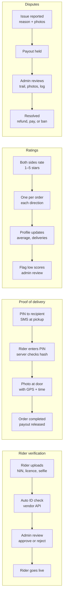

# Step 10: Verification, proof, ratings and disputes

Every handoff leaves evidence: documents, PIN, photo, ratings, history. The admin panel is where people step in.

## Rider verification

- Required: name, photo (selfie), phone (OTP-verified), NIN, driver's licence, vehicle type and plate, bank details.
- In the MVP an admin reviews every application; an ID-verification vendor can automate the NIN and licence checks later.
- Documents are stored privately in object storage and only shown to admins via short-lived signed URLs.
- Rider `status`: `pending → approved` (or `rejected`), and `approved → suspended` if needed.

## Proof of delivery

- At pickup, a 4-digit PIN is sent by SMS to the recipient. Only its hash is stored.
- At drop-off, the rider enters the PIN and takes a photo; the app attaches GPS and time.
- **Fallback:** if the recipient can't give the PIN, the rider submits a photo only and the order goes to admin review instead of auto-completing.
- After 5 wrong PIN attempts the order is locked for review.

## Ratings

- After `completed`, the customer rates the rider and the rider rates the customer, once each.
- Profiles show average rating, completed deliveries and a "Verified Rider" badge.
- Riders below a threshold (e.g. 4.0 over the last 50 deliveries) are flagged for review.

## Disputes

Reasons: package damaged, package missing, rider didn't show up, customer unavailable, wrong address, payment issue, misconduct, other.

Admin sees the order timeline (`order_events`), the route trail, all photos, and both parties' history. Outcomes: full or partial refund, pay rider, warn or suspend an account.
