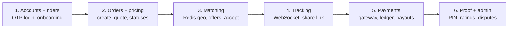

# Step 12: Roadmap, build order and stack

Ship the core loop in Lagos first; business accounts plug into the same model.

```mermaid
flowchart LR
  subgraph P1["Phase 1: MVP (Lagos, bikes)"]
    direction TB
    a1[Phone login, rider vetting]
    a2[Quote, pay, broadcast]
    a3[Live tracking, share link]
    a4[PIN + photo proof]
    a5[Ratings, basic disputes]
    a6[Admin panel]
  end
  subgraph P2["Phase 2: Scale"]
    direction TB
    b1[Scored matching]
    b2[Traffic ETA, surge pricing]
    b3[Wallets, cash on delivery]
    b4[Signature proof]
    b5[Fake-GPS and fraud checks]
    b6[Split services if needed]
  end
  subgraph P3["Phase 3: Businesses"]
    direction TB
    c1[Team members and roles]
    c2[Saved addresses]
    c3[Bulk + scheduled orders]
    c4[Monthly invoices]
    c5[Business dashboard]
    c6[Delivery API for shops]
  end
  P1 --> P2 --> P3
  style P1 fill:#dbe7f7,stroke:#2f6fd6,stroke-width:2px
```

## MVP build order

Each step ends with something demoable and tested. Payments come after tracking so the end-to-end loop can be tested with fake payments first.

## Stack

| Layer | Choice | Why |
| --- | --- | --- |
| Mobile apps | React Native (Expo) | One codebase for customer and rider apps; background location support |
| Web (admin, tracking page) | Next.js | Server-rendered tracking page loads fast on slow phones |
| API | Node.js + TypeScript + Fastify | Fast, typed, good WebSocket support |
| Database | PostgreSQL + PostGIS | Geo queries, transactions for money |
| Cache / realtime | Redis | Geo sets, pub/sub, rate limits |
| Jobs | BullMQ on Redis | Offer timeouts, payouts, reminders |
| Storage | S3-compatible bucket | Photos and ID documents |
| Monorepo | pnpm workspaces | Shared types and order status machine |

## Phase 3 fit

Because every order already belongs to an `account`, business accounts add an account type, member roles and invoice generation rather than a new data model.
